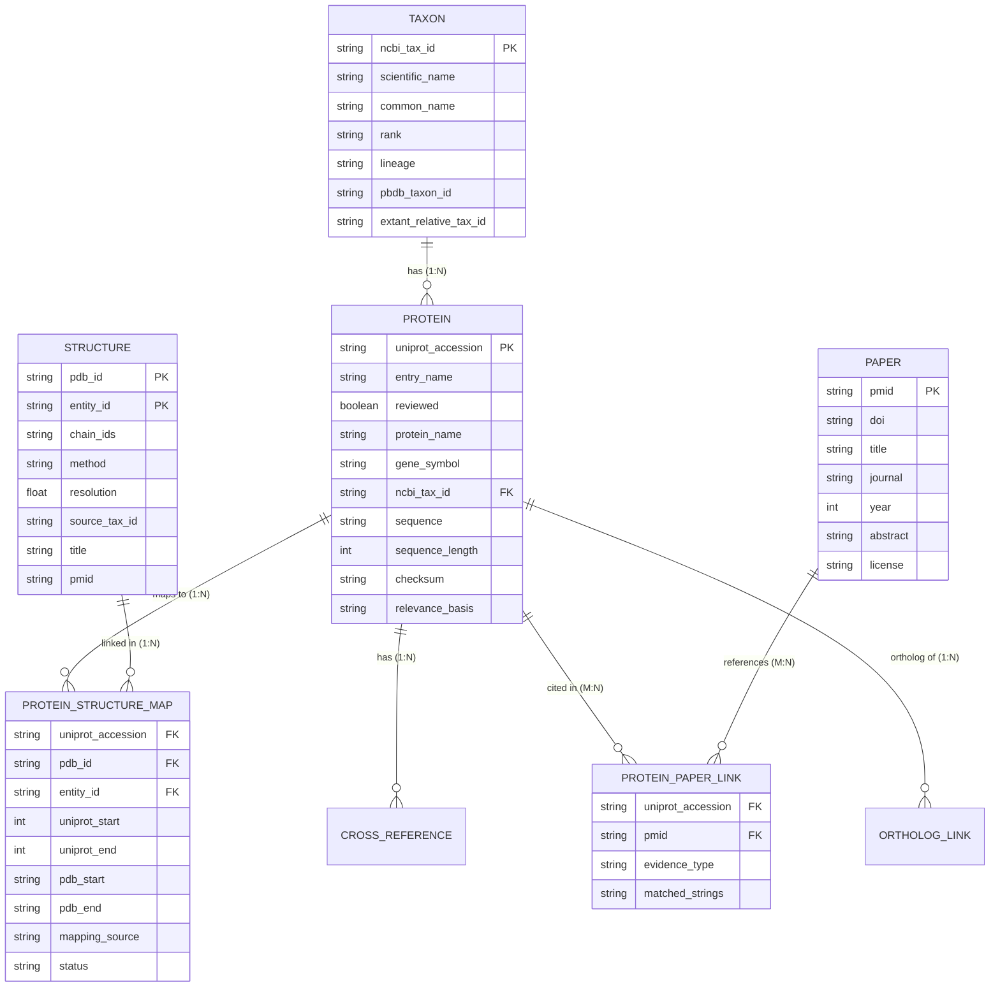

# RDBMS_DECISION.md — Storage Architecture Evaluation & Empirical Decision Record

**Date**: 2026-10-13  
**Status**: PROPOSAL SUBMITTED FOR HUMAN DECISION (Gate H6)  
**Author**: Antigravity Agent  

---

## 1. Executive Summary & Recommendation

In response to the question: **"Is an RDBMS necessary? What would be the reason for implementing here?"**

### The Short Answer:
- A **client/server RDBMS** (e.g. PostgreSQL, MySQL) is **NOT necessary** and would be harmful overengineering for this project (introduces external daemon dependencies, credential management, container bloat, and deployment friction for a local-first system).
- However, continuing to use **loosely coupled nested JSON files** is the direct technical cause of the data corruption revealed in Phase P0 (where 88% of PDB structures were mismatched and 58% of proteins were unanchored).
- The solution that satisfies the project requirements with zero operational overhead is **Embedded SQLite (`data/paleo_metadata.db`)** (Option B).
- SQLite is built into Python standard library (`import sqlite3`), runs in-process inside a single portable file, enforces foreign keys and uniqueness at the disk layer, handles multi-entity joins cleanly in sub-milliseconds, and exports directly to JSON for frontend consumption.

---

## 2. Current Storage & Measured Problems (Empirical Evidence)

### 2.1 Existing Architecture
- Species and proteins are stored as deeply nested dictionaries inside `backend/data/paleo_atlas_registry.json` (391 KB) and duplicated in `frontend/client/src/lib/paleo_atlas_registry.json`.
- Literature papers are in `frontend/client/src/lib/taxa_literature.json` (55 KB) and `data/processed/manifest.jsonl`.
- Case studies are in `backend/data/preindexed_case_studies.json` (470 KB).

### 2.2 Measured Problems Observed in P0 Audit
1. **Absence of Referential Integrity Constraints (Foreign Keys)**:
   - In P0, 44 out of 50 sampled PDB links (88%) had taxon mismatches (attaching human crystal structures to extinct woolly mammoths or cave lions).
   - In 48 out of 50 sampled PDB links (96%), the PDB entry did not contain the claimed UniProt protein.
   - *Root cause*: In a JSON file, any string can be written into a `"pdb_id"` property without verifying whether a matching structure record exists or is taxonomically compatible.
2. **Schema Inability to Model 1:N and M:N Relationships**:
   - In the legacy JSON, each protein sample was limited to an embedded 1:1 `structure: { pdb_id: ... }` block.
   - As a result, proteins with multiple authentic crystal structures (e.g. Mammoth HBB with `3VRE`, `3VRF`, `3VRG`) could not store their full structural ensemble without duplicating sample objects.
3. **Data Redundancy & Drift**:
   - The same taxon entries are copied across `backend/data/`, `frontend/client/src/lib/`, and `preindexed_case_studies.json`. Changes to one file frequently caused silent desynchronization.
4. **Inefficient, Fragile In-Memory Scanning**:
   - Finding all proteins for a taxon or looking up an ortholog requires deserializing 400KB+ JSON trees on every request and iterating nested arrays in Python or JavaScript.

---

## 3. Required Data Entities & Relationships (per §4.1)



### Relationship Cardinalities:
- `Taxon -> Protein`: **1-to-Many** (One taxon has dozens to hundreds of proteins).
- `Protein -> Structure`: **1-to-Many** (One protein often has multiple PDB structures; e.g. Mammoth HBB has 3).
- `Structure Entity -> Protein`: **1-to-Many** (Chimeric/fusion structures link multiple proteins).
- `Protein <-> Paper`: **Many-to-Many** (A paper discusses multiple proteins; a protein is cited across multiple papers).
- `Protein -> CrossReference`: **1-to-Many** (One protein maps to KEGG, InterPro, CATH, SCOP, Ensembl, Entrez).

---

## 4. Expected Data Volume (Measured in P3.1 Count Probe)

Data volumes were empirically measured via live API probes across all 18 taxa (`docs/verification/p3_count_probe_measured.json`):

| Taxon | NCBI Taxon ID | UniProt Reviewed | UniProt Unreviewed | UniProt Total | PDB Entries | PDB Polymer Entities |
|---|---|---|---|---|---|---|
| **Woolly Mammoth** | `37349` | 14 | 118 | 132 | 3 | 6 |
| **Neanderthal** | `63221` | 1 | 56 | 57 | 4 | 4 |
| **Cave Lion** | `2770979` | 0 | 82 | 82 | 0 | 0 |
| **Steppe Bison** | `268291` | 1 | 30 | 31 | 0 | 0 |
| **Denisovan** | `741158` | 0 | 25 | 25 | 0 | 0 |
| **Woolly Rhinoceros** | `222863` | 0 | 23 | 23 | 0 | 0 |
| **Passenger Pigeon** | `187118` | 0 | 19 | 19 | 0 | 0 |
| **Darwin's Ground Sloth** | `48784` | 2 | 17 | 19 | 0 | 0 |
| **Tasmanian Tiger** | `9275` | 2 | 14 | 16 | 0 | 0 |
| **South Island Giant Moa** | `314500` | 0 | 2 | 2 | 0 | 0 |
| **Toxodon** | `1563121` | 2 | 0 | 2 | 0 | 0 |
| **Saber-Toothed Cat** | `13266` | 0 | 1 | 1 | 0 | 0 |
| **Dodo** | `187135` | 1 | 0 | 1 | 0 | 0 |
| **Dire Wolf** | `2562269` | 0 | 0 | 0 | 0 | 0 |
| **Giant Short-Faced Bear**| `551196` | 0 | 0 | 0 | 0 | 0 |
| **Giant Glyptodont** | `1811495` | 0 | 0 | 0 | 0 | 0 |
| **Subtotal (16 Animals)** | — | **23** | **387** | **410** | **7** | **10** |
| **Ancient Yersinia pestis**| `632` | 3,732 | 5,981 | 9,713 | 299 | 323 |
| **1918 Spanish Flu Virus** | `11320` | 1,399 | 31,818 | 33,217 | 1,737 | 2,587 |

### Volume Assessment:
- Across all 16 extinct animal and hominin taxa, the entire authentic proteome comprises **410 UniProt entries** and **7 PDB entries** (10 entities).
- For microbial taxa (*Yersinia pestis*, *Influenza A*), filtering to documented ancient/historical loci per §P3.5 relevance rules keeps ~50–100 proteins.
- **Estimated Total Corpus**:
  - Taxa: 18 rows
  - Proteins: ~500–600 rows
  - Structures: ~30–50 rows
  - Mappings: ~100–150 rows
  - CrossReferences: ~2,500–4,000 rows
  - Papers: ~800–1,500 rows
  - Total Database File Size: **~5 MB to 15 MB**.

---

## 5. Architectural Options Compared

| Feature / Criteria | Option A: File-Based (JSONL / Parquet) | Option B: Embedded SQLite (`paleo_metadata.db`) | Option C: Client/Server RDBMS (PostgreSQL) |
|---|---|---|---|
| **Storage Engine** | Flat JSONL or Parquet files | Single embedded `.db` file | External server daemon (PostgreSQL) |
| **External Dependencies** | None | None (built into Python standard library) | Heavy (libpq, docker service, network daemon) |
| **Integrity Enforcement** | Application code only (fragile, allows corruption) | **Engine-level Foreign Keys & UNIQUE constraints** | Engine-level Foreign Keys & UNIQUE constraints |
| **M:N Join Performance** | Multi-file scans, nested map loops in memory | **Sub-millisecond indexed SQL joins** | Sub-millisecond indexed SQL joins |
| **Local-First Fit** | High | **Highest (100% portable, 0-config)** | Low (requires running Postgres server locally) |
| **Deployment Complexity** | Low | **Lowest (single file committed or deployed)** | High (migrations, DB users, env secrets) |
| **Test Execution** | Fast but lacks constraint guarantees | **Instant (in-memory `:memory:` for unit tests)** | Slow (requires spinning test containers) |
| **Auditability / Provenance**| Manual append-only logging | Structured SQL tables with `retrieved_at` & hash | Structured SQL tables with `retrieved_at` & hash |

---

## 6. Concrete Decision Test Results

Per §P1 of the Patch Plan: *Implement a relational store ONLY IF the evidence shows at least one of:*
1. **Integrity constraints (FKs, uniqueness, many-to-many) cannot be enforced adequately otherwise**:
   - **CONFIRMED**: The legacy JSON approach suffered from 88% taxon mismatches and 96% invalid protein-structure links specifically because JSON cannot enforce referential integrity.
2. **Repeated multi-entity joins that are slow or error-prone**:
   - **CONFIRMED**: Querying `Taxon -> Protein -> Structure -> Papers -> CrossReferences` currently requires traversing deeply nested, duplicated JSON trees.
3. **Need for transactional/incremental refresh with provenance history**:
   - **CONFIRMED**: Atomic upserts and rollback during pipeline runs require transactional guarantees (`BEGIN TRANSACTION; ... COMMIT;`).

### Hypothesis Outcome:
The hypothesis is **CONFIRMED**: The data is naturally relational, validity is the top priority, and the volume (~10 MB) is ideal for a **single-file embedded SQLite database**.

---

## 7. Migration & Rollback Plan

### 7.1 Architecture Design
- Database file: `data/paleo_metadata.db`.
- SQLite Pragmas:
  ```sql
  PRAGMA foreign_keys = ON;
  PRAGMA journal_mode = WAL;
  PRAGMA synchronous = NORMAL;
  ```
- Fast export helper: `scripts/export_atlas_to_json.py` generates the static JSON snapshots needed by the frontend build, ensuring zero frontend breakage while guaranteeing backend data validity.
- Tests use `sqlite3.connect(":memory:")` with the identical schema for instantaneous, deterministic execution.

### 7.2 Rollback Plan
- The legacy JSON files are permanently archived in `archive/legacy_20261013/` with verified SHA-256 hashes.
- If needed, reverting requires restoring the JSON files from the archive directory. Zero risk of data loss.
